# Segmentasi Instance pada Foto Ruangan Nyata

**EA234503 Visi Komputer – Tugas 3 (Evaluasi CPMK 3)**

| | |
|---|---|
| Nama | Royan Harits Yustanto |
| NRP | 5054241022 |
| Variabel dari NRP (digit terakhir 2) | jumlah data latih 25% / 50% / 100% |
| Dataset latih | Panoptic Indoor Segmentation **v5** (Roboflow Universe, CC BY 4.0) |
| Test set sendiri | `mycapture`: 59 foto ruangan yang saya ambil dan anotasi sendiri |
| Model | YOLO11s-seg, Mask R-CNN R50-FPN v2, Mask2Former Swin-Tiny |
| Repositori GitHub | <https://github.com/RXhy/comvis-instance-segmentation> |

---

## Ringkasan

Saya melatih tiga model segmentasi instance dari dua keluarga arsitektur (CNN dan transformer) pada dataset
Panoptic Indoor v5, masing-masing dengan 25%, 50%, dan 100% data latih. Semua model lalu diuji pada dua test set:
test set bawaan dataset (test v5) dan 59 foto yang saya ambil sendiri (mycapture).

| Model (data 100%) | Mask AP valid v5 | Mask AP test v5 | Mask AP mycapture |
|---|---|---|---|
| YOLO11s-seg | 0,212 | 0,089 | 0,070 |
| Mask R-CNN | 0,186 | 0,105 | 0,090 |
| **Mask2Former** | **0,288** | **0,165** | **0,140** |

Temuan utamanya:

- **Mask2Former paling baik** di semua test set dan di semua jumlah data.
- **Semua model lemah.** AP tertinggi hanya 0,165, jauh dari angka model yang sama di COCO (sekitar 0,38–0,45).
  Penyebab utamanya ada di data: train hanya 397 gambar untuk 74 kelas, kelasnya timpang, dan labelnya tidak konsisten.
- **Domain shift terlihat jelas.** AP di foto sendiri lebih rendah daripada di test v5 pada 9 dari 9 run (turun 14–32%).
- **Pengaruh jumlah data berbeda untuk tiap model.** Mask R-CNN naik terus, Mask2Former mendatar setelah 50%,
  dan YOLO justru turun karena *catastrophic forgetting*.
- **Kegagalan di foto sendiri lebih sering berupa salah kelas atau objek yang tidak terdeteksi**, bukan mask yang kasar.
  Contohnya, barisan kursi dikira tangga dan piring dikira panci.

---

## 1. Dataset

### 1.1 Panoptic Indoor Segmentation v5

Dataset ini berisi foto interior dengan label segmentasi untuk benda ("things", mis. kursi, botol) dan area
("stuff", mis. dinding, lantai). Kelas berakhiran `-merged` dan `-stuff` berasal dari COCO-Panoptic; misalnya
`wall-other-merged` adalah dinding biasa yang dicat atau diplester.

| Hal | Nilai |
|---|---|
| Jumlah gambar | train 397, valid 166, test 359 |
| Jumlah anotasi | train 4.479, valid 2.022, test 5.344 |
| Jumlah kelas | 74 |
| Kelas tanpa satu pun contoh di train | 9: flower, hair drier, keyboard, mouse, scissor, scissors, teddy bear, toaster, toothbrush |
| Objek terbanyak dalam satu gambar | 129 |

Sejak awal saya melihat beberapa masalah di dataset ini:

- **Datanya sedikit untuk jumlah kelas sebanyak itu.** Rata-rata hanya sekitar 5 gambar train per kelas.
- **Kelasnya sangat timpang.** `wall-other-merged` punya 756 contoh di train, sementara banyak kelas hanya punya 1–5.
- **Isi train dan test berbeda jauh.** Contohnya, `handbag` ada 5 di train tetapi 125 di test, `dining table` 4 vs 112,
  dan `wallet` justru 197 vs 5.
- **Labelnya tidak konsisten.** Ada kelas kembar dan typo (`scissor`/`scissors`, `wall`/`wall-other-merged`, `st-`).
  Kardus dilabeli `box` di train dan valid, tetapi kebanyakan dilabeli `cardboard` di test.

### 1.2 Test set sendiri (mycapture)

Saya mengambil 59 foto dengan HP (POCO X7 Pro, 4096×3072, rasio 4:3 sama dengan v5) di rumah, kamar kos,
lingkungan TC, dan ballroom. Nama file diseragamkan menjadi `mycapture_NN.jpg`; nama asli, waktu foto dari EXIF,
dan kondisi setiap foto saya catat di `rename_log.csv`.

**Kondisi foto.** 25 dari 59 foto termasuk kondisi sulit (syarat tugas minimal 10). Satu foto bisa punya lebih dari
satu label:

| Kondisi | Jumlah foto | Contoh |
|---|---|---|
| Normal | 34 | 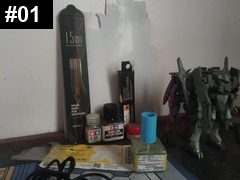 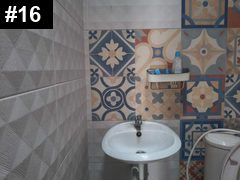 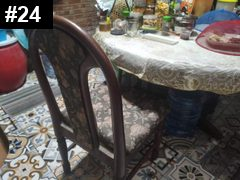 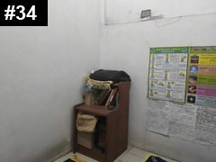 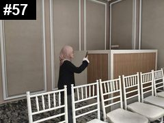 |
| Penuh (banyak objek) | 15 | 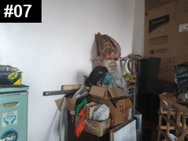 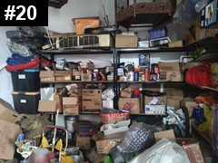 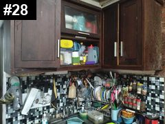 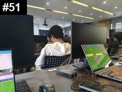 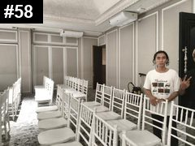 |
| Saling menutupi | 14 | 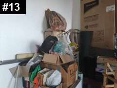 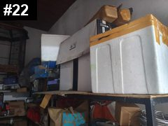 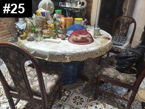 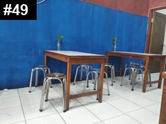 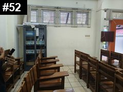 |
| Backlight (melawan cahaya) | 7 | 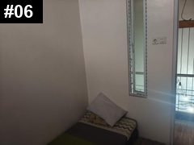 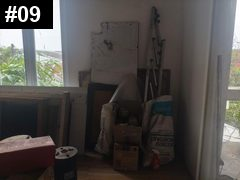 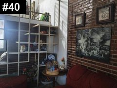 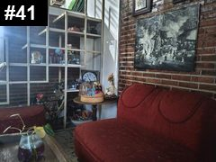 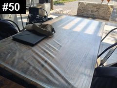 |
| Redup | 1 | 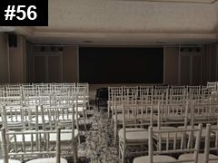 |
| Sudut ekstrem | 1 | 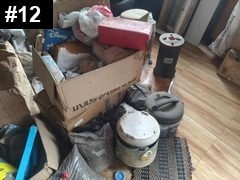 |

**Bukti EXIF.** Data EXIF ke-59 foto (merek dan model HP, waktu foto, resolusi, aperture, ISO, exposure) ada di
`bukti/exif_mycapture.csv`. Data lokasi GPS sengaja tidak saya sertakan karena berisi alamat rumah, dan foto aslinya
tidak saya unggah ke repositori karena alasan yang sama. Contoh tampilan detail foto di HP:

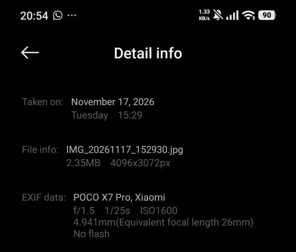

**Anotasi.** Semua foto saya anotasi manual di Roboflow (project `room_mycapture`, tipe Instance Segmentation) dengan
polygon dan nama kelas yang persis sama dengan v5. Saya tidak memakai fitur label otomatis ("Find Objects with AI"),
supaya ground truth tidak bias ke prediksi model. Smart Polygon hanya saya pakai sebagai alat bantu menggambar tepi.
Aturan yang saya pakai:

- Satu objek satu anotasi. Bagian yang tertutup benda lain tidak ikut dianotasi.
- Benda yang tidak punya kelas sendiri tetapi bentuknya mirip diberi kelas yang paling dekat, misalnya stool → `chair`,
  monitor → `tv`, toples dan galon → `bottle`, kardus → `box`. Kardus sengaja saya beri label `box`, bukan
  `cardboard`, karena `cardboard` hanya punya 2 contoh di train sehingga model praktis tidak pernah memprediksinya.
- Benda yang sama sekali tidak punya kelas yang cocok dibiarkan tanpa label.
- Kerumunan kursi di kejauhan yang tidak bisa dipisah satu per satu diberi satu polygon `chair-crowd`. Saat evaluasi,
  area ini diperlakukan sebagai area yang diabaikan (`iscrowd`), sehingga prediksi di dalamnya tidak dihitung benar
  maupun salah.

Hasil akhirnya 886 objek dalam 53 kelas, ditambah 12 area crowd. Dataset diekspor sebagai versi 1 dengan
Auto-Orient dan Resize Stretch ke 640×480, tanpa augmentasi.

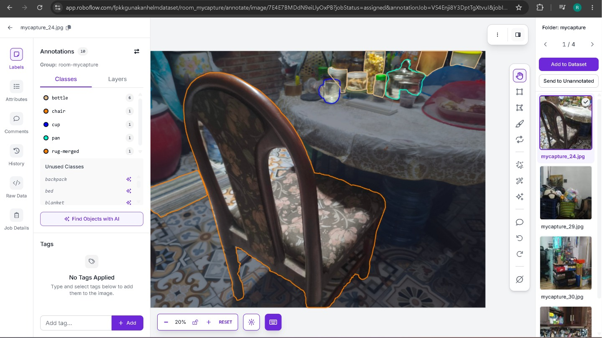

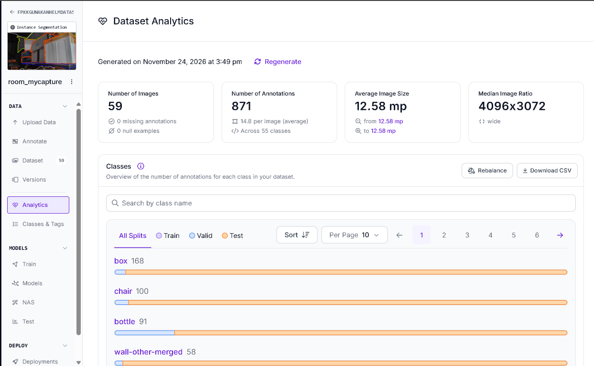

**Seberapa mirip mycapture dengan data latih?** Cukup berbeda, baik dari kelas yang muncul maupun proporsinya.
Grafik di bawah membandingkan persentase objek tiap kelas di mycapture dan di train v5. Karena jumlah objeknya
berbeda (886 vs 4.479), yang dibandingkan adalah persentase, bukan jumlah.

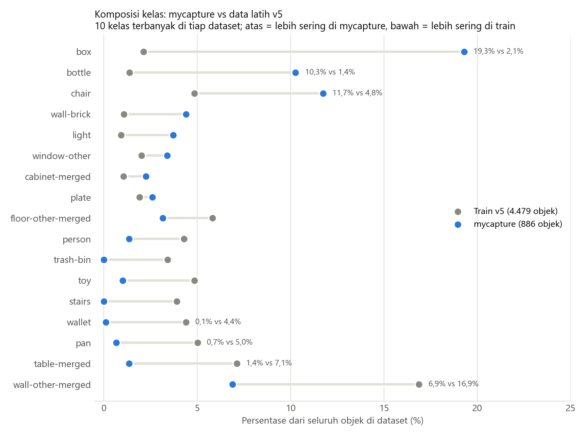

Tiga kelas terbanyak di mycapture (`box`, `chair`, `bottle`) menyumbang 41% objek, sedangkan di train ketiganya
hanya 8%. `box` saja hampir seperlima isi mycapture, tetapi cuma 2% di train. Sebaliknya, kelas yang banyak di
train seperti `wall-other-merged`, `table-merged`, `pan`, dan `wallet` jarang muncul di foto saya, dan `stairs` serta
`trash-bin` tidak muncul sama sekali.

Tabel berikut mengelompokkan 53 kelas mycapture menurut berapa banyak contohnya di train:

| Contoh di train v5 | Kelas mycapture | Objek mycapture | % objek | Kelas |
|---|---|---|---|---|
| 0 | 4 | 10 | 1,1% | scissors, toothbrush, mouse, keyboard |
| 1–9 | 15 | 86 | 9,7% | shelf, handbag, backpack, tv, laptop, curtain, clock, cell phone, sink, fork, toilet, dining table, paper-merged, refrigerator, mirror-stuff |
| 10–49 | 13 | 160 | 18,1% | wall-brick, light, cabinet-merged, rug-merged, cup, pillow, wall-tile, bed, spoon, couch, paper, blanket, window-blind |
| 50–99 | 10 | 368 | 41,5% | box, bottle, window-other, plate, potted plant, door-stuff, floor-wood, ceiling-merged, plug, stove-merged |
| 100 ke atas | 11 | 262 | 29,6% | chair, wall-other-merged, floor-other-merged, book, person, table-merged, toy, counter, pan, food-other-merged, wallet |

Jadi 19 kelas (sekitar 11% objek) hampir tidak pernah dilihat model saat training, dan hanya 30% objek mycapture
yang berasal dari kelas dengan 100 contoh train atau lebih.

---

## 2. Hipotesis

Hipotesis dicatat bertanggal di `logbook.md`. Ada dua tahap.

### 2.1 Hipotesis awal (17 Nov 2026, sebelum training)

Saya menduga **semua model akan berperforma buruk**, apa pun arsitekturnya, karena tiga hal:

1. **Kualitas dataset v5 rendah**: datanya sedikit, ada kelas typo/kembar, dan ada kelas tanpa contoh train.
2. **Ketimpangan data**, baik antar-kelas maupun antara train dan test. Akibatnya AP di test v5 akan jauh di bawah
   AP valid.
3. **Foto saya sangat berbeda dari foto train, dan foto train kurang realistis.** Foto saya diambil di rumah, kamar
   kos, lingkungan TC, dan ballroom dengan banyak kondisi sulit (penuh, backlight, redup) serta banyak benda yang
   tidak ada kelasnya. Sebaliknya, banyak foto di v5 tampaknya diambil dari internet dengan pencahayaan dan susunan
   ruangan yang rapi, sehingga kurang mencerminkan kondisi nyata. Karena itu saya memperkirakan
   **AP mycapture < AP test v5** untuk semua model.

### 2.2 Hipotesis perbandingan model (24 Nov 2026, sebelum evaluasi pada mycapture)

1. **Model terbaik adalah Mask2Former.** Arsitekturnya transformer dan dirancang khusus untuk segmentasi, sedangkan
   seri YOLO lebih mengutamakan kecepatan (real-time).
2. **Model terburuk adalah Mask R-CNN.**
3. **Kelas yang akan bagus:** dinding (`wall-other-merged`) karena porsinya paling banyak di data train, serta
   `chair` dan `person` karena contohnya di train jauh lebih banyak daripada jumlahnya di test set saya.

Hipotesis ini saya tulis setelah hasil test v5 keluar, tetapi sebelum mycapture dievaluasi, sehingga hipotesis ini
saya uji hanya pada mycapture.

---

## 3. Metode

### 3.1 Tiga model dan cara kerjanya

| Model | Keluarga | Cara membentuk mask |
|---|---|---|
| YOLO11s-seg | one-stage CNN | Membuat 32 *prototype mask* di resolusi 1/4 input (160×160 untuk input 640). Setiap deteksi punya 32 koefisien; mask objek adalah kombinasi prototype dengan koefisien itu, lalu dipotong sesuai kotaknya. |
| Mask R-CNN R50-FPN v2 | two-stage CNN | Tahap pertama mengusulkan kotak kandidat (RPN). Tahap kedua memotong fitur tiap kotak dengan RoIAlign, menentukan kelasnya, dan membuat mask **28×28** di dalam kotak itu, lalu mask diperbesar ke ukuran kotak. |
| Mask2Former Swin-Tiny | transformer | Tidak memakai kotak sama sekali. Ada 100 *query*; masing-masing memprediksi satu kelas dan satu mask (resolusi 1/4 input) lewat attention ke seluruh gambar. Saat training, setiap objek dipasangkan dengan tepat satu query (*Hungarian matching*), jadi tidak perlu NMS. |

Ketiganya mulai dari bobot pretrained COCO. Ada satu perbedaan yang ternyata penting: Ultralytics otomatis memakai
ulang bobot kepala klasifikasi YOLO untuk kelas yang namanya sama dengan kelas COCO (33 kelas), sedangkan Mask R-CNN
dan Mask2Former memulai kepala klasifikasinya dari nol.

### 3.2 Variabel NRP: 25%, 50%, 100% data latih

- Persentase hanya diterapkan ke split **train**. Split valid (166 gambar) dan test v5 (359 gambar) tetap utuh.
- Subsetnya **bertingkat**: subset 25% adalah bagian dari subset 50%, dan subset 50% bagian dari 100%
  (99 / 198 / 397 gambar, seed 42). Dengan begitu perbedaan hasil benar-benar karena jumlah data, bukan karena
  gambarnya berbeda.
- Gambar yang memuat kelas paling langka diambil lebih dulu, sehingga ketiga subset sama-sama memuat 65 dari 74 kelas
  (9 kelas sisanya memang tidak ada di train).

### 3.3 Training

Training dilakukan di Kaggle (GPU Tesla T4) dengan input sisi panjang 640. Setiap run dibatasi **40 menit**, sehingga
satu model menghabiskan paling banyak 2 jam GPU untuk tiga run. Jadwal learning rate saya buat mengikuti batas waktu,
supaya learning rate tetap turun sampai habis walaupun training terpotong waktu. Checkpoint terbaik dipilih
berdasarkan mask AP di **valid**, bukan di test.

| Model | Waktu train 25 / 50 / 100% (menit) | Epoch yang dijalankan | Epoch terbaik |
|---|---|---|---|
| YOLO11s-seg | 3,7 / 11,2 / 22,8 | 33 / 88 / 114 | 3 / 58 / 84 |
| Mask R-CNN | 16,4 / 23,9 / 40,3 | 40 / 40 / 40 | 30 / 32 / 32 |
| Mask2Former | 24,8 / 39,4 / 40,5 | 55 / 50 / 28 | 35 / 30 / 15 |

- YOLO selalu berhenti karena *early stopping* (30 epoch tanpa perbaikan). YOLO memilih epoch terbaik dengan aturan
  bawaan Ultralytics, yaitu gabungan metrik box dan mask, bukan mask AP saja seperti dua model lain.
- Mask R-CNN selalu menjalankan 40 epoch penuh.
- Mask2Former 100% hanya sempat 28 epoch karena satu epoch-nya butuh 81 detik dan batas 40 menit tercapai.

Total waktu GPU (training dan evaluasi): YOLO sekitar 40 menit, Mask R-CNN sekitar 86 menit, dan Mask2Former sekitar
110 menit. Mask2Former juga sempat menghabiskan 113 menit pada percobaan pertama yang gagal karena kehabisan memori
GPU saat evaluasi test v5 (lihat Lampiran A, kasus 5), sehingga totalnya sekitar 223 menit. Rinciannya ada di
`*/gpu_log.csv` dan tabel waktu GPU di `logbook.md`, sedangkan log setiap epoch ada di `*/<run>/results.csv`.

Sebelum dijalankan di Kaggle, ketiga notebook saya uji dulu di laptop: uji singkat satu epoch, lalu uji *overfit* pada
12 gambar. Mask R-CNN mencapai AP 0,53 dan Mask2Former 0,97 pada 12 gambar itu, yang menunjukkan bahwa pipeline dan
labelnya sudah benar.

### 3.4 Evaluasi

- Metrik utama adalah **mask AP COCO** dari pycocotools: rata-rata AP pada 10 batas IoU (0,50 sampai 0,95).
  Saya juga mencatat AP50, AP75, AP per ukuran objek (kecil, sedang, besar), dan box AP.
- Batas deteksi per gambar 200 (ada gambar berisi 129 objek, jadi batas bawaan 100 terlalu kecil).
- Prediksi dengan skor di bawah 0,05 dibuang. Nilai serendah ini memang standar untuk evaluasi (torchvision dan
  Detectron2 memakai 0,05): AP menilai model di semua threshold sekaligus lewat kurva precision–recall, sehingga
  prediksi benar yang skornya rendah tidak boleh ikut terbuang. Threshold yang lebih tinggi (0,3) hanya saya pakai
  untuk menampilkan gambar dan menghitung statistik per foto.
- Pengaturan ini sama untuk ketiga model.

Valid dan test v5 dievaluasi langsung di Kaggle. Mycapture saya evaluasi belakangan di laptop (RTX 3050), karena versi
datasetnya belum siap saat training berjalan. Supaya angka laptop dan Kaggle bisa disandingkan, saya menjalankan ulang
model 100% pada test v5 di laptop. Hasilnya sama persis:

| Model (100%) | Mask AP test v5 di laptop | di Kaggle |
|---|---|---|
| YOLO11s-seg | 0,0891 | 0,0890 |
| Mask R-CNN | 0,1049 | 0,1049 |
| Mask2Former | 0,1651 | 0,1651 |

---

## 4. Hasil

### 4.1 Pengaruh jumlah data latih (variabel NRP)

| Model | valid 25% | valid 50% | valid 100% | test v5 25% | test v5 50% | test v5 100% | mycapture 25% | mycapture 50% | mycapture 100% |
|---|---|---|---|---|---|---|---|---|---|
| YOLO11s-seg | 0,129 | 0,187 | 0,212 | **0,138** | 0,092 | 0,089 | **0,107** | 0,065 | 0,070 |
| Mask R-CNN | 0,120 | 0,158 | 0,186 | 0,062 | 0,090 | 0,105 | 0,044 | 0,061 | 0,090 |
| Mask2Former | 0,266 | **0,314** | 0,288 | 0,146 | 0,164 | **0,165** | 0,122 | 0,135 | **0,140** |

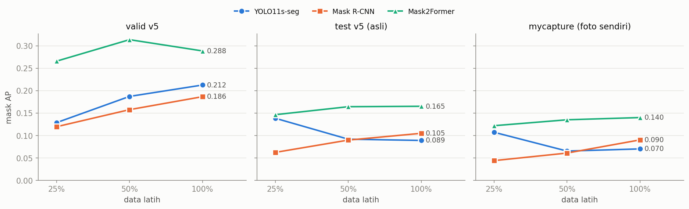

Ketiga model bereaksi berbeda terhadap tambahan data:

- **Mask R-CNN** naik terus di semua test set. AP mycapture-nya dua kali lipat dari 25% ke 100% (0,044 → 0,090).
  Model ini paling "lapar data", karena kepala klasifikasinya mulai dari nol.
- **Mask2Former** naik dari 25% ke 50%, lalu mendatar. Di test v5, 50% dan 100% praktis sama (0,164 vs 0,165).
  Penyebabnya batas waktu: run 100% hanya sempat 28 epoch, sehingga jumlah langkah training-nya hampir sama dengan run
  50%. Dengan anggaran GPU yang tetap, menggandakan data tidak menambah AP.
- **YOLO** justru turun di test v5 dan mycapture saat data ditambah, padahal di valid naik (0,129 → 0,212).
  Ini akibat *catastrophic forgetting* yang saya bahas di Kasus 2. Temuan ini juga menunjukkan bahwa memilih model
  hanya dari angka valid bisa menyesatkan.

Jadi jawaban "berapa persen data yang paling baik" bergantung pada modelnya. Untuk Mask R-CNN jawabannya 100%,
untuk Mask2Former 50% dan 100% hampir sama, dan untuk YOLO di test set justru 25%. Kombinasi terbaik secara
keseluruhan adalah Mask2Former dengan data 100%.

### 4.2 Domain shift: test v5 dibanding foto sendiri

| Model | Run | test v5 | mycapture | Perubahan |
|---|---|---|---|---|
| YOLO11s-seg | 25% / 50% / 100% | 0,138 / 0,092 / 0,089 | 0,107 / 0,065 / 0,070 | −23% / −29% / −21% |
| Mask R-CNN | 25% / 50% / 100% | 0,062 / 0,090 / 0,105 | 0,044 / 0,061 / 0,090 | −29% / −32% / −14% |
| Mask2Former | 25% / 50% / 100% | 0,146 / 0,164 / 0,165 | 0,122 / 0,135 / 0,140 | −17% / −18% / −15% |

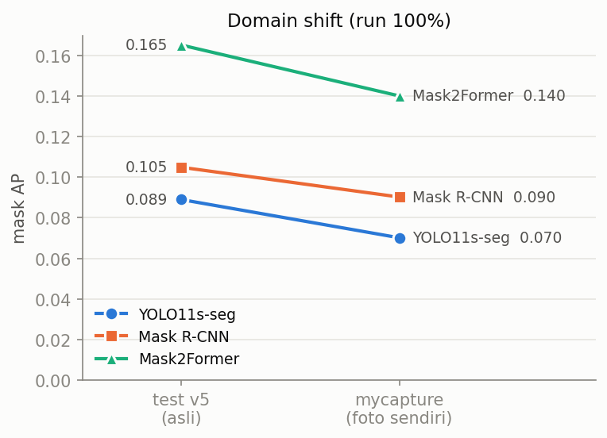

Semua run turun saat diuji di foto sendiri. Penurunan paling kecil ada di Mask R-CNN 100% dan Mask2Former. Menariknya,
penurunan ini masih lebih kecil daripada selisih valid ke test v5 (misalnya Mask2Former 0,288 → 0,165). Artinya test
v5 sendiri sudah cukup berbeda dari train dan valid, sesuai dengan temuan label kardus `box` vs `cardboard` tadi.

### 4.3 Detail metrik di mycapture (data 100%)

| Model | Mask AP | AP50 | AP75 | AP objek kecil | AP objek sedang | AP objek besar | Box AP |
|---|---|---|---|---|---|---|---|
| YOLO11s-seg | 0,070 | 0,109 | 0,072 | 0,022 | 0,050 | 0,118 | 0,081 |
| Mask R-CNN | 0,090 | 0,144 | 0,104 | 0,011 | 0,056 | 0,190 | 0,093 |
| Mask2Former | 0,140 | 0,240 | 0,127 | 0,032 | 0,089 | 0,270 | 0,142 |

Objek kecil (luas di bawah 32×32 piksel) hampir tidak pernah tersegmentasi dengan benar oleh model mana pun (AP
0,01–0,03). Keunggulan Mask2Former paling terlihat di objek besar. Box AP hampir sama dengan mask AP, yang berarti
masalah utamanya ada di menemukan objek dan menebak kelasnya, bukan di kerapian mask.

### 4.4 AP per kelas di mycapture (data 100%)

Sepuluh kelas terbaik (rata-rata AP ketiga model):

| Kelas | Objek di mycapture | Contoh di train | YOLO | Mask R-CNN | Mask2Former | Rata-rata |
|---|---|---|---|---|---|---|
| ceiling-merged | 9 | 77 | 0,557 | 0,735 | 0,669 | 0,654 |
| laptop | 5 | 8 | 0,376 | 0,346 | 0,700 | 0,474 |
| wall-other-merged | 61 | 756 | 0,402 | 0,399 | 0,443 | 0,415 |
| person | 12 | 192 | 0,383 | 0,313 | 0,502 | 0,399 |
| floor-wood | 10 | 99 | 0,172 | 0,469 | 0,441 | 0,361 |
| pillow | 11 | 39 | 0,353 | 0,260 | 0,442 | 0,351 |
| bed | 6 | 26 | 0,204 | 0,223 | 0,336 | 0,254 |
| sink | 4 | 8 | 0,000 | 0,379 | 0,355 | 0,245 |
| floor-other-merged | 28 | 261 | 0,161 | 0,245 | 0,141 | 0,182 |
| door-stuff | 10 | 64 | 0,146 | 0,218 | 0,102 | 0,155 |

Beberapa kelas yang sering muncul tetapi gagal:

| Kelas | Objek di mycapture | Contoh di train | Rata-rata AP | Catatan |
|---|---|---|---|---|
| box | 171 | 95 | 0,147 | kelas terbanyak di mycapture |
| bottle | 91 | 62 | 0,072 | banyak yang kecil |
| chair | 104 | 217 | 0,031 | sering dikira `stairs` (Kasus 1) |
| plate | 23 | 86 | 0,000 | dikira `pan` (Kasus 3) |
| light | 33 | 41 | 0,000 | lampu kecil di plafon |
| keyboard, mouse | 2 dan 2 | 0 | 0,000 | tidak ada contoh train (Kasus 2) |

Tabel lengkap untuk 53 kelas ada di `hasil_lokal/per_class_AP_mycapture_100pct.csv`.

### 4.5 AP per kondisi foto (data 100%)

| Kondisi | Jumlah foto | YOLO | Mask R-CNN | Mask2Former |
|---|---|---|---|---|
| Semua | 59 | 0,070 | 0,090 | 0,140 |
| Normal | 34 | 0,100 | 0,145 | 0,177 |
| Penuh | 15 | 0,092 | 0,092 | 0,162 |
| Saling menutupi | 14 | 0,133 | 0,130 | 0,219 |
| Backlight | 7 | 0,098 | 0,130 | 0,191 |
| Redup | 1 | 0,167 | 0,150 | 0,324 |
| Sudut ekstrem | 1 | 0,025 | 0,128 | 0,301 |

Saya tidak menemukan pola "foto sulit pasti AP-nya rendah" yang konsisten. Pada YOLO dan Mask2Former, foto yang
objeknya saling menutupi malah lebih tinggi daripada foto normal; hanya Mask R-CNN yang sedikit turun pada foto
backlight dan saling menutupi (0,130 vs 0,145). Ada tiga alasan:

- Jumlah fotonya kecil. Kondisi redup dan sudut ekstrem masing-masing hanya satu foto, jadi angkanya tidak bisa
  dijadikan pegangan.
- AP setiap kelompok dirata-rata dari kelas yang berbeda-beda, sehingga isi foto lebih berpengaruh daripada
  pencahayaannya.
- Foto "penuh" kebanyakan adalah foto kelas dan ballroom yang berisi kursi, dan kursi gagal karena alasan lain
  (lihat Kasus 1).

---

## 5. Uji hipotesis

| No | Hipotesis | Bukti | Status |
|---|---|---|---|
| 2.1.1 | Semua model berperforma buruk | Mask AP 100% hanya 0,07–0,14 di mycapture dan 0,09–0,17 di test v5, padahal model yang sama mencapai sekitar 0,38–0,45 di COCO | **Terdukung** |
| 2.1.2 | AP test v5 jauh di bawah AP valid | Valid vs test v5 (100%): YOLO 0,212 vs 0,089; Mask R-CNN 0,186 vs 0,105; Mask2Former 0,288 vs 0,165 | **Terdukung** |
| 2.1.3 | AP mycapture < AP test v5 | Turun di 9 dari 9 run, sebesar 14–32% | **Terdukung** |
| 2.2.1 | Mask2Former terbaik | Terbaik di semua jumlah data: 0,122 / 0,135 / 0,140 di mycapture | **Terdukung** |
| 2.2.2 | Mask R-CNN terburuk | Benar di 25% (0,044) dan 50% (0,061 vs YOLO 0,065), tetapi salah di 100% (Mask R-CNN 0,090, YOLO 0,070) | **Sebagian** |
| 2.2.3 | `wall-other-merged` bagus | AP rata-rata 0,415, peringkat 3 dari 53 kelas | **Terdukung** |
| 2.2.3 | `person` bagus | AP rata-rata 0,399, peringkat 4 dari 53 kelas | **Terdukung** |
| 2.2.3 | `chair` bagus | AP hanya 0,013–0,048, peringkat 30 dari 53, padahal ada 217 contoh train | **Tidak terdukung** |

### Kenapa sebagian hipotesis saya keliru

**Kursi ternyata termasuk kelas terburuk.** Alasan "contohnya di train banyak" ternyata tidak cukup:

1. Kursi di mycapture berbeda jenis dengan kursi di v5. Kursi di v5 kebanyakan kursi rumah yang berdiri sendiri,
   sedangkan kursi di foto saya banyak yang berupa kursi kuliah, kursi banket ballroom, dan stool besi yang tersusun
   rapat. Barisan kursi seperti itu dikira tangga (`stairs`) oleh Mask R-CNN dan Mask2Former.
2. YOLO "melupakan" kursi yang ia kenal dari COCO. AP kursinya turun dari 0,083 (data 25%) menjadi 0,013 (data 100%).
3. Alasan saya bahwa jumlah kursi di test set sedikit juga kurang tepat. Yang menentukan bukan jumlah objek di test,
   melainkan seberapa mirip tampilannya dengan yang dipelajari model.

**Mask R-CNN bukan yang terburuk pada data 100%.** Urutan YOLO dan Mask R-CNN tertukar karena cara keduanya memulai
training berbeda. YOLO mendapat "bonus" pengetahuan COCO di awal, dan bonus itu hilang makin lama ia dilatih di v5
(0,107 → 0,065 → 0,070). Mask R-CNN mulai dari nol, jadi ia terus membaik seiring bertambahnya data
(0,044 → 0,061 → 0,090). Ternyata urutan model di sini lebih ditentukan oleh interaksi antara jumlah data dan cara
kepala klasifikasi diinisialisasi, bukan oleh "YOLO fokus kecepatan".

**Kenapa Mask2Former unggul.** Setiap query Mask2Former langsung memprediksi satu mask utuh dan dilatih dengan loss di
tingkat mask, tanpa bergantung pada kotak dan tanpa NMS. Keunggulannya paling besar pada objek besar (AP 0,27 vs
0,12–0,19) dan kelas berbentuk area seperti jendela (`window-other` 0,256 vs 0,02–0,03).

---

## 6. Analisis lima kegagalan

Saya memilih lima foto dari daftar foto dengan recall terendah. Setiap foto mewakili jenis kegagalan yang berbeda dan
bisa dikaitkan dengan mekanisme model. Untuk setiap kasus saya membuat dugaan penyebab, lalu mengujinya dengan satu
eksperimen kecil.

| Kasus | Foto | Kegagalan | Dugaan penyebab | Eksperimen | Dugaan terbukti? |
|---|---|---|---|---|---|
| 1 | #55 ballroom | barisan kursi dikira tangga | klasifikasi region, bukan ukuran | crop + zoom | Ya, masalahnya klasifikasi |
| 2 | #51 lab komputer | keyboard, mouse, monitor tidak terdeteksi | kepala klasifikasi YOLO dari COCO lalu terlupakan | bandingkan run 25/50/100% | Ya |
| 3 | #28 rak piring | piring dikira panci | resolusi fitur terlalu rendah | crop + zoom | Ya untuk Mask R-CNN dan Mask2Former |
| 4 | #41 ruang tamu backlight | banyak objek luput | foto terlalu gelap | koreksi gamma | Hanya untuk YOLO |
| 5 | #49 kafe | mask stool berkaki tipis buruk | resolusi mask 28×28 dan prototype YOLO | batas atas 28×28, input YOLO lebih besar | Tidak, dugaan terbantah |

Pada setiap gambar, panel kiri adalah anotasi saya dan panel lain adalah prediksi tiap model (data 100%, skor ≥ 0,3).
Tanda `*` berarti area crowd.

### Kasus 1 – Foto #55 (ballroom): barisan kursi dikira tangga

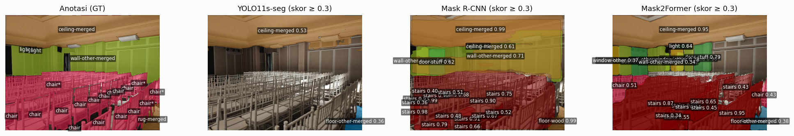

**Apa yang terjadi.** Foto ini berisi 13 kursi banket yang saya anotasi satu per satu, ditambah area kerumunan kursi
di belakang. Tidak ada satu pun yang tersegmentasi sebagai `chair`. YOLO sama sekali tidak mendeteksi apa pun di area
kursi, sedangkan Mask R-CNN dan Mask2Former menutupi barisan kursi dengan mask besar berlabel `stairs`. Ini bukan
kejadian sekali saja: di seluruh mycapture, yang tidak memuat satu tangga pun, Mask R-CNN membuat 88 prediksi
`stairs` (skor ≥ 0,3) di 20 foto, dan Mask2Former 46 di 8 foto.

**Kenapa.** Mask R-CNN menentukan kelas dari fitur di dalam satu kotak proposal, dan Mask2Former dari satu query yang
mask-nya menutupi satu area. Barisan sandaran kursi putih yang berulang membentuk pola garis horizontal sejajar yang
mirip anak tangga. Kelas `stairs` punya 175 contoh di train, sedangkan kursi banket tidak ada sama sekali di v5. Jadi
classifier memilih kelas yang pola visualnya paling mirip dengan yang pernah ia lihat.

**Eksperimen.** Kalau masalahnya kursi terlalu kecil di input 640, memotong area kursi lalu memperbesarnya seharusnya
membuat kursi terdeteksi.

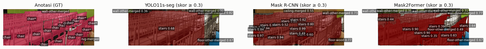

**Hasil.** Setelah di-zoom, tetap tidak ada kursi yang dikenali sebagai `chair`, dan Mask2Former malah menambah satu
prediksi `stairs`. Jadi ukuran bukan penyebabnya. Masalahnya ada di **klasifikasi**: tampilan kursi banket berderet
tidak pernah ada di data latih.

### Kasus 2 – Foto #51 (lab komputer): keyboard, mouse, dan monitor tidak terdeteksi

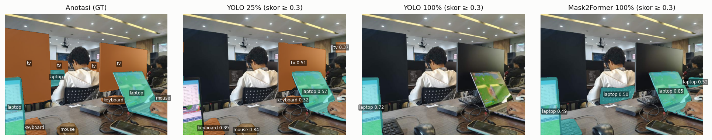

**Apa yang terjadi.** Foto ini memuat 4 monitor (`tv`), 2 keyboard, 2 mouse, dan 3 laptop. Di train v5, keyboard dan
mouse tidak punya contoh sama sekali, dan `tv` hanya 2. Satu-satunya model yang bisa menyegmentasi ketiganya adalah
**YOLO dengan data 25%**:

| Model dan data | tv (4) | keyboard (2) | mouse (2) | laptop (3) |
|---|---|---|---|---|
| YOLO 25% | 1 | 2 | 1 | 1 |
| YOLO 50% dan 100% | 0 | 0 | 0 | 1 |
| Mask R-CNN (semua run) | 0 | 0 | 0 | 0–1 |
| Mask2Former (semua run) | 0 | 0 | 0 | 0–2 |

Angka di tabel adalah jumlah objek yang tersegmentasi benar (IoU ≥ 0,5, kelas sama, skor ≥ 0,3).

**Kenapa.** Saat fine-tuning, Ultralytics menyalin bobot kepala klasifikasi COCO untuk kelas yang namanya sama,
termasuk keyboard, mouse, dan tv. Jadi YOLO memulai training dengan kemampuan mengenali benda-benda ini. Run 25%
berhenti di epoch terbaik ke-3, sehingga kemampuan itu masih utuh. Run 50% dan 100% dilatih jauh lebih lama (epoch
terbaik 58 dan 84) di v5 yang tidak punya keyboard atau mouse, sehingga kelas-kelas itu terus ditekan sebagai latar
belakang sampai akhirnya hilang. Inilah *catastrophic forgetting*. Mask R-CNN dan Mask2Former memulai kepala
klasifikasinya dari nol, jadi keduanya tidak pernah bisa mengenali kelas tanpa contoh train.

**Eksperimen.** Saya membandingkan run 25%, 50%, dan 100%. Arsitektur dan bobot awalnya sama; yang berbeda hanya
jumlah data dan lama training.

**Hasil.** Kemampuan itu hilang begitu training lebih panjang (25% → 50%). Pola yang sama muncul pada AP kursi YOLO
(0,083 → 0,006 → 0,013) dan pada test v5 untuk kelas keyboard, mouse, dan scissors. Kemampuan yang dibawa dari
bobot pretrained ternyata rapuh. Cara mempertahankannya antara lain membekukan sebagian kepala klasifikasi, mencampur
sedikit data COCO saat fine-tuning, atau menambah contoh kelas tersebut ke data latih.

### Kasus 3 – Foto #28 (dapur, rak piring): piring dikira panci

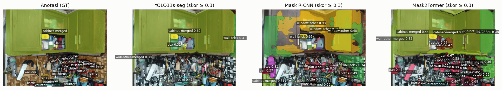

**Apa yang terjadi.** Ini foto dengan recall terendah di seluruh mycapture. Isinya 36 objek kecil yang saling
menempel: 8 piring berdiri di rak, gelas, sendok, garpu, gunting, sikat gigi, dan botol. Tidak ada piring yang
dikenali sebagai `plate`; sebagian besar tidak terdeteksi, dan sisanya dilabeli `pan` (panci atau wajan).

**Kenapa.** Di input 640×480, sebuah piring yang berdiri di rak hanya selebar beberapa piksel. Ketiga model membentuk
mask dari peta fitur beresolusi rendah (1/4 input atau lebih kasar), sehingga detail tepi yang membedakan piring dari
panci hampir hilang. Ketika fiturnya ambigu, classifier condong ke kelas yang lebih sering ia lihat: `pan` punya 225
contoh train, sedangkan `plate` hanya 86.

**Eksperimen.** Area rak saya potong lalu perbesar sekitar 3,7 kali.

| Model | Piring dikenali sebagai `plate`, foto penuh | Setelah zoom |
|---|---|---|
| YOLO11s-seg | 0 dari 8 | 0 dari 8 |
| Mask R-CNN | 0 dari 8 | 3 dari 8 |
| Mask2Former | 0 dari 8 | 6 dari 8 |

**Hasil.** Berbeda dengan Kasus 1, di sini **resolusi memang penyebab utama** bagi Mask R-CNN dan Mask2Former. YOLO
tetap tidak mendeteksi apa pun, jadi pada YOLO ada faktor lain, yaitu kepala klasifikasi yang terkena *forgetting* dan
kapasitas model yang kecil. Untuk objek kecil yang rapat seperti ini, perbaikan yang masuk akal adalah memotong gambar
menjadi beberapa bagian (tiling) atau inferensi di resolusi lebih tinggi dengan model yang dilatih pada skala itu.

### Kasus 4 – Foto #41 (ruang tamu, backlight)

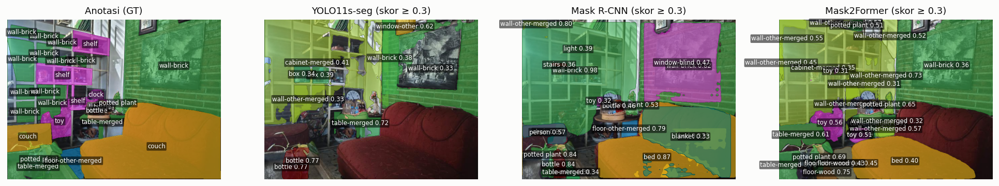

**Apa yang terjadi.** Ruang tamu ini difoto melawan cahaya jendela, sehingga bagian dalam ruangan (sofa, rak, mainan,
jam) gelap. Dari 28 objek, recall-nya rendah untuk semua model: YOLO 0,04, Mask R-CNN 0,07, Mask2Former 0,14.

**Dugaan.** Foto di v5 kebanyakan berpencahayaan rata. Di area gelap, kontras tepi dan warna mengecil, sehingga fitur
awal CNN (yang dinormalisasi dengan statistik dari data latih) ikut melemah. Kalau dugaan ini benar, mencerahkan
bagian gelap seharusnya menolong.

**Eksperimen.** Koreksi gamma 0,5 (mencerahkan bagian gelap, anotasi tetap) pada ketujuh foto backlight.

| Model | Mask AP asli | Setelah koreksi gamma | Selisih |
|---|---|---|---|
| YOLO11s-seg | 0,097 | 0,126 | +0,030 |
| Mask R-CNN | 0,129 | 0,126 | −0,003 |
| Mask2Former | 0,235 | 0,157 | −0,078 |

**Hasil.** Dugaan "kurang terang" hanya berlaku untuk YOLO, model terkecil dengan backbone CNN. Mask2Former, dengan
backbone Swin yang memakai LayerNorm dan attention, ternyata sudah cukup tahan terhadap foto gelap; koreksi gamma
justru menggeser distribusi warna dan memperkuat noise sehingga hasilnya memburuk. Rendahnya recall di #41 lebih
banyak disebabkan isi fotonya: banyak benda kecil seperti mainan, jam, dan rak yang contohnya di train sedikit atau
bentuknya berbeda. Ini sejalan dengan tabel kondisi foto, di mana AP foto backlight tidak jauh berbeda dari foto
normal. Pelajarannya, preprocessing pencahayaan tidak bisa diterapkan sama rata ke semua model. Karena hanya 7 foto,
hasil ini bersifat indikatif.

### Kasus 5 – Foto #49 (kafe, stool besi berkaki tipis)

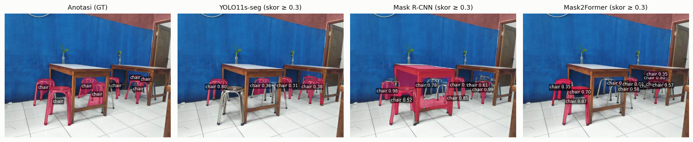

**Apa yang terjadi.** Kafe ini punya 8 stool besi berkaki tipis. Mask dari ketiga model buruk: IoU rata-rata dengan
anotasi hanya 0,31–0,35. Banyak stool tertangkap sebagai satu gumpalan, atau hanya dudukannya saja.

**Dugaan.** Struktur tipis seharusnya paling dirugikan oleh mask beresolusi rendah. Mask R-CNN membuat mask di grid
28×28 lalu memperbesarnya ke ukuran kotak, dan YOLO membentuk mask dari prototype 160×160.

**Eksperimen (a): batas atas grid 28×28.** Mask anotasi setiap stool saya kecilkan ke 28×28 lalu perbesar kembali,
persis seperti yang dialami mask head Mask R-CNN. Kalau grid 28×28 memang pembatasnya, IoU-nya akan rendah.

| Ukuran | Rata-rata IoU |
|---|---|
| Batas atas grid 28×28 (mask anotasi yang dikecilkan lalu diperbesar) | 0,973 |
| IoU yang dicapai YOLO | 0,312 |
| IoU yang dicapai Mask R-CNN | 0,324 |
| IoU yang dicapai Mask2Former | 0,354 |

Untuk seluruh objek mycapture, batas atas 28×28 rata-rata 0,985 (paling rendah `shelf` 0,924, rak bertiang tipis).

**Eksperimen (b): YOLO dengan input lebih besar.** Ukuran input YOLO saya naikkan dari 640 ke 960 dan 1280, sehingga
prototype mask ikut lebih tajam.

| Ukuran input YOLO | Resolusi prototype | Mask AP mycapture | IoU stool #49 |
|---|---|---|---|
| 640 | 160×160 | 0,070 | 0,312 |
| 960 | 240×240 | 0,062 | 0,292 |
| 1280 | 320×320 | 0,046 | 0,124 |

**Hasil.** Dugaan resolusi mask **terbantah**. Grid 28×28 hampir tidak kehilangan detail (0,973), padahal model hanya
mencapai sekitar 0,32. Memperbesar input YOLO juga malah memperburuk hasil, karena model dilatih di 640 sehingga
ukuran objek tidak lagi sesuai dengan skala yang dipelajarinya. Kegagalan sebenarnya ada pada **pengenalan dan
lokalisasi objek**: kotak atau query yang tidak pas, dan stool besi yang jarang ada di v5. Perbaikan yang lebih tepat
adalah menambah contoh kursi dan stool dari lingkungan seperti ini ke data latih, bukan menaikkan resolusi mask.

---

## 7. Kesimpulan

1. **Mask2Former paling baik** di ketiga set evaluasi dan ketiga jumlah data. Pada data 100%, mask AP-nya 0,288
   (valid), 0,165 (test v5), dan 0,140 (mycapture).
2. **Semua model lemah pada dataset ini**, sesuai hipotesis awal. Penyebab utamanya data: train hanya 397 gambar,
   kelasnya timpang, labelnya tidak konsisten antar-split, dan ada kelas tanpa contoh.
3. **Domain shift nyata.** AP di foto sendiri lebih rendah daripada di test v5 pada semua run (−14% sampai −32%).
4. **Efek menambah data bergantung pada model.** Mask R-CNN naik terus, Mask2Former mendatar setelah 50% dengan
   anggaran 40 menit, dan YOLO justru turun karena *catastrophic forgetting* pada kelas COCO.
5. **Kegagalan di foto sendiri lebih sering berupa salah kelas atau objek yang tidak terdeteksi**: kursi berderet dikira
   tangga, piring dikira panci, dan kelas tanpa contoh hilang. Eksperimen pada grid 28×28 dan prototype YOLO
   menunjukkan bahwa resolusi mask bukan pembatas utama.

### Keterbatasan

- Mycapture hanya 59 foto, dan banyak kelas hanya punya 1–5 objek, sehingga AP per kelas dan per kondisi kurang stabil.
- Semua anotasi saya buat sendiri, dan polygon tidak menelusuri detail yang sangat tipis (kaki kursi, rangka rak).
- Batas 40 menit per run membuat jumlah data dan lama training saling terkait. Mask2Former 100% hanya sempat 28 epoch.
- Roboflow memperkecil foto mycapture ke 640×480, sehingga detail kecil berkurang (relevan untuk Kasus 3).
- Setiap eksperimen kegagalan hanya memakai 1–7 foto, jadi hasilnya indikatif, bukan uji statistik.

---

## 8. Bukti proses

| Bukti | Lokasi |
|---|---|
| Logbook mingguan (kendala, keputusan, hipotesis bertanggal, waktu GPU) | `logbook.md` |
| Download dan statistik dataset | `01_download_dataset.ipynb`, `outputs/class_stats_v5.csv` |
| Notebook training (dijalankan di Kaggle) | `02_train_yolo11seg.ipynb`, `03_train_maskrcnn.ipynb`, `04_train_mask2former.ipynb` |
| Log training per epoch | `yolo11s/<run>/results.csv`, `maskrcnn/<run>/results.csv`, `mask2former/<run>/results.csv` |
| Catatan waktu GPU | `yolo11s/gpu_log.csv`, `maskrcnn/gpu_log.csv`, `mask2former/gpu_log.csv` |
| Metrik valid dan test v5 (Kaggle) | `*/metrics.csv`, `*/<run>/per_class_AP_*.csv` |
| Inferensi dan evaluasi mycapture, semua tabel dan gambar di laporan ini | `05_inferensi_evaluasi.ipynb`, folder `hasil_lokal/` |
| Notebook demo (inferensi foto baru) | `06_demo.ipynb` |
| Data foto sendiri: nama asli, waktu foto, kondisi | `rename_log.csv` |
| EXIF 59 foto (tanpa GPS) | `bukti/exif_mycapture.csv`, `bukti/exif_hp_mycapture_01.png` |
| Panduan dan screenshot anotasi | `annotation_checklist.md`, folder `bukti/` |
| Repositori dan riwayat commit Git | <https://github.com/RXhy/comvis-instance-segmentation> |

---

## Lampiran A. Deklarasi penggunaan AI

AI (Claude, lewat Claude Code) dipakai untuk:
- memahami tugas dan menganalisis statistik dataset;
- menyusun rencana foto dan panduan anotasi Roboflow;
- memilih model;
- menulis kode notebook (download data, subset, training, evaluasi, laporan), modul `lib/`, dan script rename.

Seluruh pengambilan foto, anotasi, dan keputusan akhir dikerjakan sendiri.

### Prompt utama

| No | Prompt (ringkas) | Dipakai untuk |
|---|---|---|
| 1 | "aku mau tau classnya apa aja biar aku bisa ambil foto … buat notebook untuk download" | notebook 01 dan daftar kelas |
| 2 | "kasih saran apa aja yang harus difoto" | rencana foto |
| 3 | "apakah fotoku terlalu sulit" | evaluasi komposisi foto |
| 4 | "saran modelnya apa aja" | pemilihan model |
| 5 | "bantu aku buat notebook untuk training 3 modelnya, untuk train di kaggle" | notebook 02–04 |
| 6 | "kamu bisa tau objek di mycapture apa aja, dan yang tidak ada kelasnya" | `annotation_checklist.md` |

### Kasus saran/kode AI yang salah dan perbaikannya

| No | Kasus | Cara ketahuan | Perbaikan |
|---|---|---|---|
| 1 | **AP@[.50:.95] selalu 0.** Kode evaluasi dari AI mengambil `COCOeval.stats`. Karena batas deteksi diubah menjadi 200, fungsi ringkasan pycocotools (yang selalu mencari `maxDets=100`) mengembalikan −1 → tercatat 0 | Smoke test: AP50 0,33 tapi AP 0,00, tidak masuk akal | AP dihitung langsung dari tabel `precision` hasil `accumulate()`, dicocokkan dengan pycocotools pada `maxDets=100` → identik (0,2158 vs 0,2158) |
| 2 | **Daftar kelas awal tidak akurat.** Daftar 93 kelas dari AI diambil dari halaman project Roboflow dan memuat typo | Setelah file COCO v5 dianalisis, v5 hanya punya 74 kelas | Daftar resmi diambil dari file anotasi v5 (`outputs/class_names_v5.txt`) |
| 3 | **`!pip install` di notebook lokal** bisa memasang package ke Python yang berbeda dari kernel | – | Diganti `%pip install` |
| 4 | **Script rename ikut mengganti file tersembunyi** bernama `.jpg` menjadi `mycapture_49.jpg` | File tidak terlihat saat pengecekan awal, baru ketahuan setelah rename | Isi file dicek (foto asli HP, EXIF 18 Nov 12:34), waktu foto dilengkapi manual di `rename_log.csv` |
| 5 | **Mask2Former CUDA out of memory.** Fungsi prediksi dari AI memperbesar 50 mask sekaligus ke resolusi asli; gambar test v5 sampai 3024×3398 butuh 3,8 GB | Run Kaggle gagal; smoke test lokal tidak menangkap karena gambarnya kecil | Jumlah mask per potongan disesuaikan ukuran gambar; puncak memori di 4 gambar terbesar 1,06 GB |
| 6 | **Log training per epoch rusak.** `append_csv` dari AI menulis header dari baris pertama saja; kolom AP valid baru muncul di epoch evaluasi | `results.csv` tidak bisa dibaca pandas | Fungsi menulis ulang header kalau ada kolom baru; file lama diperbaiki dengan menambah 2 nama kolom di header, isi data tidak diubah |
