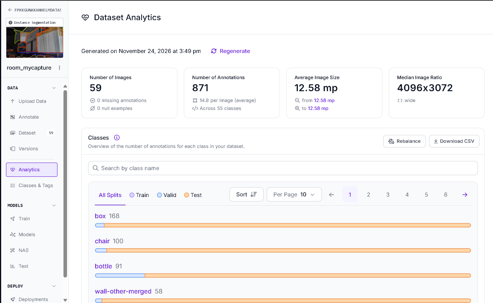
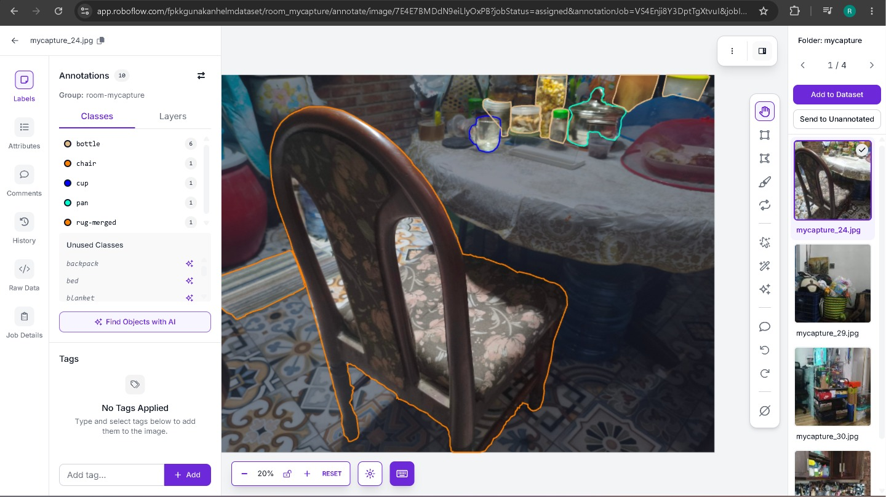

# Logbook Tugas 3 – Segmentasi Instance (Evaluasi CPMK 3)

- **Mata kuliah:** EA234503 Visi Komputer
- **Dataset latih:** Panoptic Indoor Segmentation **v5** (Roboflow Universe, `panopticindoor/panoptic-indoor-segmentation`, CC BY 4.0)
- **Variabel NRP (digit terakhir 2):** jumlah data latih **25% / 50% / 100%**
- **Model:** YOLO11s-seg (one-stage CNN), Mask R-CNN R50-FPN v2 (two-stage CNN), Mask2Former Swin-Tiny (transformer)

> Logbook ini mencatat kendala dan keputusan secara kronologis. Entri bertanda **[TODO]** belum dikerjakan.

---

## 17 Nov 2026 – Memahami tugas dan dataset

**Yang dikerjakan**
- Membaca slide tugas (PDF pertemuan 10). Poin wajib: ≥3 model dari ≥2 keluarga, test set foto sendiri ≥40 foto
  (≥10 kondisi sulit), anotasi di Roboflow dengan kelas yang sama, analisis domain shift, 5 analisis kegagalan
  + eksperimen kecil, log training, catatan waktu GPU, logbook, deklarasi AI.
- Membuat notebook `01_download_dataset.ipynb` untuk download v5 (format COCO segmentation) dan menghitung statistik per kelas.

**Kendala**
- Download pertama gagal dengan error `A valid API key must be provided`. Penyebabnya bukan key yang salah:
  variabel `API_KEY` kosong karena key tidak ter-paste di kotak input dan urutan eksekusi cell terbalik.
  **Solusi:** cell API key diberi pengecekan (berhenti kalau kosong, menampilkan panjang key yang terbaca).

**Temuan dari statistik dataset v5** (`outputs/class_stats_v5.csv`)
| Hal | Nilai |
|---|---|
| Jumlah gambar | train 397, valid 166, test 359 |
| Jumlah anotasi | train 4.479, valid 2.022, test 5.344 |
| Jumlah kelas | **74** (halaman project menampilkan 93, termasuk kelas typo yang tidak ada di v5) |
| Kelas tanpa contoh di train | 8: toothbrush, mouse, keyboard, flower, scissors, teddy bear, toaster, hair drier |
| Instance terbanyak per gambar | 129 (di split test) |
| Ketidakcocokan train vs test | handbag 5 vs 125, dining table 4 vs 112, curtain 3 vs 107, wallet 197 vs 5, trash-bin 153 vs 4, box 95 vs 1 |
| Sisa masalah label di v5 | `st-` (1), `scissor` vs `scissors`, `wall` vs `wall-other-merged`, `paper` vs `paper-merged` |

**Keputusan**
- Kelas `*-merged` dan `*-stuff` dipahami sebagai kelas "stuff" dari COCO-Panoptic (mis. `wall-other-merged` = dinding cat/plester biasa).
- Ketidakcocokan train–test v5 dicatat sebagai **domain shift bawaan dataset** untuk dibahas di laporan.

---

## 17 Nov 2026 – Pembagian data dan rencana eksperimen

**Keputusan**
- Persentase 25/50/100% **hanya diterapkan pada split `train`**. Split `valid` (166) dan `test` v5 (359) tetap utuh.
- Foto sendiri **hanya dipakai sebagai test set kedua**, tidak ikut training, supaya analisis domain shift valid.
- Pemilihan model/checkpoint memakai **`valid`**, bukan test set. Kedua test set hanya untuk laporan akhir,
  dan **semua model** dievaluasi di kedua test set (sesuai instruksi tugas).
  (Ide awal "pilih model terbaik di test asli lalu hanya model itu yang dites ke foto sendiri" dibatalkan karena
  tidak sesuai instruksi dan membuat test set ikut dipakai untuk memilih model.)

---

## 17 Nov 2026 – Pengambilan foto test set sendiri

**Yang dikerjakan**
- Mengambil 43 foto dengan HP (POCO X7 Pro, 4096×3072, rasio 4:3 sama dengan v5), EXIF tersimpan.
  Lokasi: rumah (kamar, gudang, dapur, kamar mandi, ruang makan, ruang tamu, balkon).
- Ditambah 5 foto malam (22:06) yang lebih sederhana: meja laptop, lemari, kasur, gorden.

**Kendala & evaluasi**
- Review foto: banyak foto gudang yang sangat penuh (#20–#23), banyak foto yang hampir sama sudut pandangnya,
  belum ada `person`, belum ada kondisi benar-benar redup. Komposisi terlalu didominasi foto sulit.
- Satu foto memuat voucher dengan barcode/QR → perlu ditutup/blur sebelum diupload/dilampirkan.

**Keputusan**
- Foto diganti nama menjadi `mycapture_NN.jpg` (urut waktu). Nama asli dan waktu foto dicatat di `rename_log.csv`.
- Benda yang tidak ada kelasnya di dataset **dibiarkan tanpa label** (tidak membuat kelas baru, tidak dipaksakan ke kelas mirip).

**Hipotesis awal** (disampaikan saat pengambilan foto, sebelum training; baru dicatat ke logbook pada 24 Nov 2026)

Dugaan saya: secara keseluruhan **semua model akan berperforma buruk**, apa pun arsitekturnya. Ada tiga alasan:
1. **Kualitas dataset v5 rendah.** Train hanya 397 gambar untuk 74 kelas, ada kelas typo/duplikat
   (`scissor`/`scissors`, `wall`/`wall-other-merged`, `st-`), dan ada 8 kelas tanpa contoh train sama sekali.
2. **Ketimpangan data.**
   - *Antar-kelas:* `wall-other-merged` punya 756 instance, sedangkan banyak kelas hanya punya 1–5.
   - *Antar-split:* distribusi kelas train dan test sangat berbeda (handbag 5 vs 125, dining table 4 vs 112, wallet 197 vs 5).
   - Karena itu, AP di test v5 diperkirakan jauh di bawah AP valid.
3. **mycapture sangat berbeda dari data train.** Foto diambil dari rumah, kafe, kelas, dan ballroom Indonesia, dengan
   banyak kondisi sulit (penuh, backlight, redup) dan banyak benda yang tidak ada kelasnya.
   - Prediksi terukurnya: **AP mycapture < AP test v5** untuk semua model (domain shift).

**Status hipotesis (diperbarui 24 Nov 2026)**
- (1) **Terdukung.** Mask AP test v5 tertinggi hanya 0,165 (Mask2Former 100%), dan YOLO 100% hanya 0,089.
  Sebagai pembanding kasar, mask AP ketiga model di COCO menurut model card-nya sekitar 0,38–0,45
  (YOLO11s-seg 0,378; Mask R-CNN v2 0,418; Mask2Former Swin-T 0,450).
  Kelas tanpa contoh train (`keyboard`, `mouse`, `scissors`) hanya bisa dikenali YOLO yang masih "ingat" COCO.
- (2) **Terdukung.** Gap valid vs test v5 besar di ketiga model, misalnya Mask R-CNN 0,187 vs 0,105 dan Mask2Former 0,289 vs 0,165.
  Ada juga inkonsistensi label antar-split: kardus = `box` di train, tapi `cardboard` di test.
- (3) **Terdukung** (dievaluasi 24 Nov). AP mycapture lebih rendah dari test v5 di 9 dari 9 run (−14% s.d. −32%).
  Detail di `05_laporan_utama.ipynb` bagian 5.3.

---

## 18–21 Nov 2026 – Anotasi di Roboflow & tambahan foto

**Yang dikerjakan**
- Project Roboflow `room_mycapture` (tipe **Instance Segmentation**), anotasi dimulai dari `mycapture_04`.
- Tambahan 13 foto (19 & 21 Nov): kafe, lab komputer, ruang kelas, ballroom, termasuk foto dengan orang.
  Total **61 foto**. Rename otomatis dengan `rename_mycapture.py`.
- Dibuat `annotation_checklist.md`: daftar kelas yang perlu dianotasi dan benda tanpa kelas untuk setiap foto.

**Kendala**
- Bingung perbedaan tampilan polygon vs "mask" (tampilan pratinjau menambahkan kotak otomatis).
  **Keputusan:** anotasi memakai **polygon**, sama dengan format v5. Kotak yang muncul hanya turunan otomatis dari polygon.
- Alat Bounding Box sempat aktif tanpa sengaja di editor → selalu pastikan alat Polygon/Smart Polygon yang dipakai.
- Di foto kamar mandi (#16), dinding keramik sempat diberi label `wall-other-merged` → **diperbaiki menjadi `wall-tile`**.
- Lupa menambah vertex pada polygon → dokumentasi Roboflow tidak menjelaskan cara menambah vertex ke polygon jadi;
  solusi: edit lewat alat Drag/Select atau gambar ulang polygon.
- Ada file foto bernama hanya `.jpg` (tanpa nama) yang ikut di-rename menjadi `mycapture_49.jpg`;
  waktu fotonya diisi dari EXIF (18 Nov 12:34).

**Aturan anotasi yang ditetapkan**
- **Things** (chair, person, bottle, bed, dll): satu objek = satu anotasi, walaupun terpotong benda lain.
  Kalau penghalang tipis → satu polygon melewati penghalang; kalau besar → Brush/mask satu anotasi, atau bagian
  terlihat terbesar saja.
- **Stuff** (wall, floor, ceiling, rug): satu polygon per area yang tersambung. Kalau terpotong benda sampai terpisah
  → polygon terpisah. Ini sesuai pola v5 (lebih dari separuh gambar train memecah `wall-other-merged` menjadi ≥3 potongan).
- Hanya bagian yang **terlihat** yang dianotasi (konsisten dengan asal dataset panoptic). Tumpang tindih kecil di tepi tidak masalah.
- Satu objek hanya boleh punya **satu kelas** (tidak boleh label ganda).
- Benda yang menempel di dinding bukan bagian dinding: dipotong dari polygon dinding. Kalau punya kelas
  (bottle, clock, mirror-stuff, plug, light) dianotasi sendiri; kalau tidak (rak sabun, poster, lukisan) dibiarkan.
  Benda sangat kecil (paku, saklar kecil) boleh ikut dinding.
- Pemetaan benda ambigu: stool/bangku → `chair`; bangku kayu berbantal → `couch`; monitor → `tv`; tablet → `cell phone`;
  lemari laci plastik/loker/kabinet dapur → `cabinet-merged`; rak terbuka → `shelf`; toples/galon → `bottle`;
  kontainer plastik/styrofoam → `box`; meja makan bundar → `dining table`; backsplash mozaik/panel → `wall-tile`;
  karpet ballroom → `rug-merged`; kardus → `box` (bukan `cardboard`); pakaian/kresek/keranjang → tanpa label.
- Kelas typo (`cuo`, `cyo`, dll.) **tidak dipakai**; nama kelas selalu dicek ke `outputs/class_names_v5.txt`.
- **Tidak memakai "Find Objects with AI" / Label Assist**, supaya ground truth tidak bias ke prediksi model.
  Smart Polygon (SAM) dipakai hanya sebagai alat bantu menggambar tepi; kelas dan objek ditentukan sendiri, hasil dicek manual.

---

## 23 Nov 2026 – Pemilihan model dan notebook training

**Keputusan model** (GPU lokal hanya RTX 3050 6 GB → training di **Kaggle, GPU T4**)
| Model | Keluarga | Library | Alasan |
|---|---|---|---|
| YOLO11s-seg | one-stage CNN | Ultralytics | cepat; mask dari *prototype* resolusi rendah (relevan analisis kegagalan) |
| Mask R-CNN R50-FPN v2 | two-stage CNN | torchvision | mask head 28×28 per RoI (disebut di materi); mudah dipakai di Windows/Kaggle |
| Mask2Former Swin-Tiny | transformer | Hugging Face | tanpa proposal/box, mask dari *query*; pembanding arsitektur |

**Protokol eksperimen** (`02_train_yolo11seg.ipynb`, `03_train_maskrcnn.ipynb`, `04_train_mask2former.ipynb`)
- Subset **bertingkat** 25% ⊂ 50% ⊂ 100% dengan seed 42. Gambar yang memuat kelas langka diambil lebih dulu supaya
  sebanyak mungkin kelas masih terwakili di subset 25%. Daftar gambar & jumlah kelas per subset disimpan.
- Semua model pakai bobot pretrained COCO, ukuran input sisi panjang 640.
- Batas waktu **40 menit per run** (3 run × 40 menit = 2 jam GPU per model, sesuai catatan tugas).
  Jadwal learning rate ikut menyesuaikan batas waktu supaya tetap selesai turun.
- Checkpoint terbaik dipilih berdasarkan mask AP di `valid`.
- Evaluasi **sama untuk semua model**: pycocotools (mask AP & box AP), `MAX_DET=200` (karena ada gambar 129 objek),
  `SCORE_THRESH=0.05`, di valid, test v5, dan mycapture.
- Output: `metrics.csv`, `gpu_log.csv`, `results.csv` per run, AP per kelas, prediksi COCO, overlay prediksi foto sendiri.
- Kelas dari project Roboflow foto sendiri dipetakan ke 74 kelas v5 **berdasarkan nama**; anotasi dengan nama yang tidak
  dikenal dibuang dan dilaporkan di output.

**Uji kode lokal (RTX 3050, bukan training resmi)**
- Smoke test ketiga notebook (12 gambar, 1 epoch): semua berjalan sampai selesai.
- Uji overfit 12 gambar: Mask R-CNN mencapai mask AP 0,53 di data latih; Mask2Former 0,97 → pipeline training dan label benar.
- Beberapa epoch lokal sempat sangat lambat saat suhu GPU laptop 86 °C (kemungkinan throttling), tidak relevan untuk Kaggle.

**Catatan perbedaan antar model**
- Ultralytics otomatis menginisialisasi kepala klasifikasi YOLO untuk **33 kelas yang namanya sama dengan COCO**;
  Mask R-CNN dan Mask2Former mulai kepala klasifikasi dari nol. Dibahas sebagai faktor saat membandingkan hasil.
- Augmentasi mengikuti resep bawaan masing-masing (YOLO: mosaic dll.; Mask R-CNN: flip + photometric; Mask2Former: flip).

### 23 Nov 2026 – Hasil Kaggle pertama (YOLO dan Mask R-CNN)

**Kendala**
- Split **mycapture tidak ikut dievaluasi** di kedua run (tidak ada `preds_mycapture.json`). Download dari Roboflow
  gagal lalu dilewati (`PERINGATAN: test set foto sendiri dilewati` di log). Bobot model tersimpan, jadi evaluasi
  mycapture bisa diulang tanpa training ulang (`RUN_TRAIN=False`, `WEIGHTS_FROM=<folder hasil>`).

**Temuan**
- Mask AP (valid / test_v5):
  - YOLO 25% = 0,129 / 0,138; 50% = 0,187 / 0,092; 100% = 0,213 / 0,089.
  - Mask R-CNN 25% = 0,120 / 0,062; 50% = 0,158 / 0,090; 100% = 0,187 / 0,105.
- Mask R-CNN naik terus saat data ditambah. **YOLO di test_v5 justru turun** saat data ditambah.
- Penyebabnya: run YOLO 25% punya best epoch = 3, jadi isinya hampir model COCO pretrained. AP rata-rata di test_v5:
  - Kelas yang ada di COCO: 0,30 → 0,08 (25% → 100%).
  - Kelas non-COCO: 0,00 → 0,10.
  - Ini *catastrophic forgetting*: model belajar kelas baru tapi melupakan kelas COCO.
- Penurunan terbesar ada di `mouse`, `keyboard`, dan `scissors`, padahal ketiganya **tidak punya contoh train di v5**.
  Pada run 25% kelas ini masih "diingat" dari COCO, lalu terlupakan karena training lebih lama. Ini relevan untuk #51.
- Gap valid vs test_v5 juga besar di Mask R-CNN (0,19 vs 0,10). Artinya test_v5 tidak sepenuhnya sedistribusi dengan valid.

### 23–24 Nov 2026 – Hasil Mask2Former

- Run ulang dengan notebook yang sudah diperbaiki berhasil. Split mycapture kembali dilewati, jadi dievaluasi belakangan.
- Mask AP (valid / test_v5): 25% = 0,266 / 0,146; 50% = 0,314 / 0,164; 100% = 0,289 / 0,165.
  Ini **model terbaik di semua fraksi**, sekitar 1,5× AP Mask R-CNN di test_v5.
- AP valid run 100% lebih rendah dari run 50%:
  - Dengan batas 40 menit, run 100% hanya sempat 28 epoch (81 detik/epoch).
  - Jumlah iterasinya hampir sama dengan run 50%: ±2.800 vs ±2.500 langkah.
  - AP valid sudah mendatar di ~0,28 sejak epoch 15.
  - Di test_v5, 50% dan 100% praktis sama (0,164 vs 0,165).
  - Kesimpulan: dengan anggaran waktu tetap, menggandakan data dari 50% ke 100% tidak menambah AP. Valid juga hanya 166 gambar, jadi selisih ±0,02 masih dalam batas noise.
- AP test_v5 kelas COCO vs non-COCO: 0,16 / 0,13 (25%) → 0,17 / 0,16 (100%). Tidak terjadi *forgetting* seperti di YOLO.
- Kendala: `results.csv` Mask2Former dan Mask R-CNN tidak bisa dibaca pandas, karena header ditulis dari baris epoch tanpa
  kolom AP valid. Kode pencatat diperbaiki dan 6 file diperbaiki tanpa mengubah isinya (lihat kasus AI no. 6).

### 24 Nov 2026 – Hipotesis perbandingan model (sebelum evaluasi mycapture)

> Catatan waktu: hipotesis ini ditulis 24 Nov 2026, **setelah** training dan evaluasi test v5 selesai (23 Nov), tapi
> **sebelum** evaluasi pada test set sendiri (mycapture) dan sebelum analisis kegagalan. Ringkasan angka test v5 sudah
> sempat muncul di percakapan dengan AI, jadi hipotesis ini hanya diuji pada **mycapture**.

**Hipotesis (dalam kata-kata saya)**
1. **Model terbaik: Mask2Former.** Arsitekturnya transformer dan dirancang khusus untuk segmentasi. Seri YOLO
   lebih mengutamakan kecepatan inferensi (real-time).
2. **Model terburuk: Mask R-CNN.**
3. **Kelas yang akan bagus:**
   - dinding (`wall-other-merged`), karena porsinya paling banyak di data train;
   - `chair` dan `person`, karena contohnya di train jauh lebih banyak dibanding jumlahnya di test set saya.

**Cara menguji:** urutan mask AP ketiga model pada split mycapture (run 100%), dan AP per kelas mycapture
(`per_class_AP_mycapture.csv`) untuk `wall-other-merged`, `chair`, dan `person` dibanding rata-rata kelas lain.

**Status (dievaluasi 24 Nov 2026, `05_laporan_utama.ipynb` bagian 6)**
- (1) Mask2Former terbaik: **terdukung** di semua fraksi (mycapture 0,122 / 0,135 / 0,140).
- (2) Mask R-CNN terburuk: **sebagian**. Benar di 25% dan 50%, tapi salah di 100%: YOLO 0,070 < Mask R-CNN 0,090,
  karena YOLO terkena *catastrophic forgetting*.
- (3) Kelas yang bagus:
  - `wall-other-merged` dan `person` **terdukung** (peringkat 3 dan 4 dari 53 kelas).
  - `chair` **tidak terdukung**: peringkat 30, AP 0,013–0,048. Barisan kursi ballroom/kelas dikira `stairs`, dan YOLO
    melupakan kursi COCO.

### 24 Nov 2026 – Foto #60 dan #61 dihapus

- Foto **#60 dan #61** (ballroom, redup, penuh kursi dan orang) dihapus dari folder dan Roboflow karena resolusinya
  berbeda dari foto lain. Barisnya juga dihapus dari `rename_log.csv`, supaya foto baru berikutnya bisa memakai
  nomor 60 tanpa dobel di log.
- Test set sekarang **59 foto**, dengan **25 foto kondisi sulit** (syarat ≥ 40 dan ≥ 10 tetap terpenuhi).
- Kondisi `redup` tinggal 1 foto (#56), jadi analisis per kondisi untuk "redup" lemah.

### 24 Nov 2026 – Anotasi mycapture selesai, dataset dibuat di Roboflow

**Yang dikerjakan**
- Semua foto dimasukkan ke dataset Roboflow `room_mycapture` (Instance Segmentation), lalu dibuat versi pada 24 Nov 2026 pukul 15.49.
- Statistik dari halaman **Dataset Analytics** Roboflow:

| Hal | Nilai |
|---|---|
| Jumlah gambar | 59 (0 tanpa anotasi, 0 null) |
| Jumlah anotasi | 871 (rata-rata 14,8 per gambar) |
| Kelas yang dipakai | 55 |
| Ukuran gambar | 4096×3072 (12,58 MP), semuanya sama |
| Kelas terbanyak | `box` 168, `chair` 100, `bottle` 91, `wall-other-merged` 58 |

**Kendala**
- Pembagian split di Roboflow tidak bisa diubah ke 100% test. Hasilnya **Train 0 / Valid 2 / Test 57**.
  Ini tidak berpengaruh, karena notebook menggabungkan semua split mycapture menjadi satu test set berisi 59 foto,
  dan tidak ada foto mycapture yang dipakai untuk training.
- Saat generate, daftar kelas project tertulis **76**, padahal yang dipakai anotasi hanya 55. Selisihnya adalah kelas yang
  terdaftar tapi tidak dipakai (mis. sisa typo `ceilig`). Kelas yang tidak dipakai tidak berpengaruh. Nama kelas yang
  dipakai anotasi akan dicek lagi dari file export.

**Bukti (screenshot)**
- Pembagian split: `bukti/roboflow_split_2026-11-24.png`
- Dataset Analytics: `bukti/roboflow_analytics_2026-11-24.png`
- Contoh proses anotasi (`mycapture_24`, polygon per objek): `bukti/roboflow_anotasi_mycapture_24.png`

### 24 Nov 2026 – Cek export mycapture dan persiapan notebook laporan

**Pemeriksaan export** (`data/room_mycapture.v1i.coco-segmentation`, format COCO Segmentation)
- Hasil export: 59 foto 640×480 (valid 1, test 58) dan 898 polygon. Jumlahnya sedikit berbeda dari screenshot Analytics
  karena ada perbaikan anotasi setelah screenshot diambil (mis. #24 sekarang sudah punya `dining table`, lantai, dan `wall-brick`).
- Kelas yang tidak ada di v5:
  - `chair-crowd` (12 polygon di 7 foto): disengaja, untuk area kerumunan kursi.
  - `nox` (1 anotasi di #46): typo dari `box`.
- **Keputusan:**
  - `nox` dipetakan ke `box` saat evaluasi (`MYCAP_MERGE = {"nox": "box"}` di notebook laporan), tanpa membuat versi Roboflow baru.
  - `<kelas>-crowd` dibaca sebagai `<kelas>` dengan `iscrowd=1`, sehingga pycocotools memperlakukannya sebagai area abaikan.
- #50 (kafe, backlight) tidak punya anotasi dinding/lantai/plafon. Ini wajar karena latar fotonya area luar.

**Persiapan evaluasi lokal**
- Kode inferensi dipindah ke `lib/models.py`, `lib/common.py`, dan `lib/analysis.py`, dengan preprocessing yang sama
  persis dengan notebook training.
- **Uji reproduksi** (test v5, run 100%, laptop RTX 3050 vs Kaggle T4):
  - YOLO 0,0891 vs 0,0890.
  - Mask R-CNN 0,1049 vs 0,1049.
  - Mask2Former 0,1651 vs 0,1651.
  - Bobot dan kode inferensi lokal terbukti sama dengan saat training.
- Notebook utama `05_laporan_utama.ipynb` dibuat sebagai pengganti laporan, berisi hipotesis, tahapan,
  inferensi, hasil, pembahasan, dan analisis kegagalan.

### 24 Nov 2026 – Evaluasi mycapture dan analisis kegagalan (`05_laporan_utama.ipynb`)

- Inferensi 3 model × 3 fraksi di mycapture dijalankan di laptop (RTX 3050), masing-masing 3–15 detik untuk 59 foto.
- Mask AP mycapture:

| Model | 25% | 50% | 100% |
|---|---|---|---|
| YOLO | 0,107 | 0,065 | 0,070 |
| Mask R-CNN | 0,044 | 0,061 | 0,090 |
| Mask2Former | 0,122 | 0,135 | 0,140 |

- 5 studi kasus beserta eksperimennya:
  - **#55:** kursi berderet → `stairs`. Zoom tidak menolong, jadi masalahnya klasifikasi, bukan ukuran.
  - **#51:** keyboard/mouse hanya dikenali YOLO 25% (*forgetting*).
  - **#28:** piring → `pan`. Zoom menolong Mask R-CNN dan Mask2Former, jadi masalahnya resolusi.
  - **#41:** backlight. Gamma 0,5 menolong YOLO (+0,030) tapi merusak Mask2Former (−0,078).
  - **#49:** stool. Batas atas grid 28×28 = 0,973 vs IoU tercapai ~0,32, dan YOLO `imgsz` lebih besar justru lebih
    buruk. Hipotesis resolusi mask terbantah.

### 24 Nov 2026 – Keputusan anotasi: kardus = `box`, bukan `cardboard`

**Kendala.** v5 punya dua kelas yang sama-sama bisa dipakai untuk kardus, yaitu `box` dan `cardboard`.

**Data dari `outputs/class_stats_v5.csv`**

| Kelas | Instance train | Valid | Test |
|---|---|---|---|
| `box` | 95 | 85 | 1 |
| `cardboard` | 2 | 0 | 14 |

**Keputusan.** Semua kardus, kotak sepatu, dan kontainer bertutup di mycapture dilabeli **`box`**.

**Alasan**
- `cardboard` hanya punya 2 contoh di train, jadi model praktis tidak belajar kelas itu dan hampir tidak pernah
  memprediksinya. Kalau kardus dilabeli `cardboard`, AP kelas itu otomatis ≈ 0. Prediksi `box` yang secara visual benar
  juga ikut dihitung salah (false positive), sehingga yang terukur adalah ketidakcocokan label, bukan kemampuan model.
- `box` punya 95 contoh train, dan di train serta valid v5 kardus memang dilabeli `box`. Keputusan ini mengikuti
  kebiasaan label di data yang dipelajari model.

**Temuan sampingan.** v5 tidak konsisten antar-split. Kardus dilabeli `box` di train dan valid, tapi kebanyakan `cardboard`
di test (14 vs 1). Ini salah satu penjelasan kenapa AP test_v5 jauh di bawah AP valid di ketiga model. Bisa dibahas di
laporan sebagai contoh inkonsistensi label antar-split, bersama typo `scissor`/`scissors`.

**Keputusan tertunda**
- [TODO] `CLASS_MERGE`: menggabungkan `scissor→scissors`, `wall→wall-other-merged`, membuang `st-` (total 5 anotasi).
  Kalau dipakai, harus sama di ketiga notebook.
- [TODO] Mengurangi foto ballroom (#55, #56, #59–#61) dan gudang (#20–#23) yang sangat berat dianotasi.
- [TODO] Izin dari orang yang wajahnya ada di foto (#51, #53, #54, #57, #58).

---

## Catatan waktu GPU

| Tanggal | Tempat | Model | Run | Menit | Keterangan |
|---|---|---|---|---|---|
| 23 Nov 2026 | Lokal RTX 3050 | ketiga model | smoke test | < 10 per model | uji kode, bukan hasil resmi |
| 23 Nov 2026 | Kaggle T4 | YOLO11s-seg | 025 / 050 / 100pct | train 3,7 / 11,2 / 22,8; eval 0,7 / 0,7 / 0,8 | total ≈ 40 menit; early stop di epoch 33 / 88 / 114 (`yolo11s/gpu_log.csv`) |
| 23 Nov 2026 | Kaggle T4 | Mask R-CNN | 025 / 050 / 100pct | train 16,4 / 23,9 / 40,3; eval 2,0 / 1,9 / 1,7 | total ≈ 86 menit; 40 epoch penuh, best epoch 30 / 32 / 32 (`maskrcnn/gpu_log.csv`) |
| 23 Nov 2026 | Kaggle T4 | Mask2Former | percobaan 1 | [TODO] | gagal: CUDA OOM saat evaluasi test v5 (lihat kasus AI no. 5) |
| 23 Nov 2026 | Kaggle T4 | Mask2Former | 025 / 050 / 100pct | train 24,8 / 39,4 / 40,5; eval 1,8 / 1,7 / 2,0 | total ≈ 110 menit; 55 / 50 / 28 epoch, best epoch 35 / 30 / 15 (`mask2former/gpu_log.csv`) |

---

## Deklarasi penggunaan AI

AI (Claude, lewat Claude Code) dipakai untuk: memahami tugas, menganalisis statistik dataset, menyusun rencana foto,
panduan anotasi Roboflow, memilih model, dan menulis kode notebook (download data, subset, training, evaluasi) serta script rename.
Semua keputusan akhir dan seluruh anotasi dikerjakan sendiri.

**Prompt utama yang dipakai** (ringkas):
1. "aku mau tau classnya apa aja biar aku bisa ambil foto … buat notebook untuk download"
2. "itu udah ada outputnya, interpretasiin … wall other merged apaan"
3. "kasih saran apa aja yang harus difoto"
4. "apakah fotoku terlalu sulit"
5. "cara annotate di roboflow gimana" / "pake polygon aman kan"
6. "saran modelnya apa aja"
7. "buatin notebook untuk training 3 modelnya, aku mau train di kaggle"
8. "kamu bisa tau objek di mycapture apa aja, dan yang tidak ada kelasnya"

**Kasus saran/kode AI yang salah atau tidak cocok, dan perbaikannya**
1. **Bug evaluasi AP@[.50:.95] selalu 0.** Kode evaluasi awal dari AI mengambil angka dari `COCOeval.stats`. Karena
   batas deteksi diubah menjadi 200, fungsi ringkasan bawaan pycocotools (yang selalu mencari `maxDets=100`) mengembalikan
   −1 → tercatat 0, padahal AP50 > 0. Ketahuan saat smoke test (AP50 0,33 tapi AP 0,00, tidak masuk akal).
   **Perbaikan:** AP dihitung langsung dari tabel `precision` hasil `accumulate()`, lalu dicocokkan dengan pycocotools
   pada `maxDets=100` → hasil identik (0,2158 vs 0,2158).
2. **Daftar kelas awal tidak akurat.** Daftar pertama yang diberikan AI (93 kelas) diambil dari halaman project Roboflow
   dan memuat kelas typo. Setelah file COCO v5 dianalisis, ternyata v5 hanya punya **74 kelas** dan sebagian besar typo
   tidak ada. **Perbaikan:** daftar resmi diambil dari file anotasi v5 (`outputs/class_names_v5.txt`).
3. **Install package di notebook lokal.** Cell awal memakai `!pip install`, yang di Jupyter lokal bisa memasang package ke
   Python yang berbeda dari kernel. **Perbaikan:** diganti `%pip install`.
4. **Script rename ikut mengganti nama file tersembunyi.** File bernama `.jpg` (tanpa nama) tidak terlihat saat pengecekan
   awal dan ikut di-rename menjadi `mycapture_49.jpg`. **Perbaikan:** isi file dicek (foto asli dari HP, EXIF 18 Nov 12:34)
   dan waktu foto dilengkapi manual di `rename_log.csv`.
5. **Mask2Former CUDA out of memory saat evaluasi test v5.** Fungsi prediksi dari AI memperbesar 50 mask sekaligus ke
   resolusi asli gambar. Test v5 ternyata punya gambar sampai 3024×3398 (~10 MP), jadi satu alokasi butuh 3,8 GB dan
   run di Kaggle gagal. Smoke test lokal tidak menangkapnya karena hanya memakai beberapa gambar kecil. **Perbaikan:**
   jumlah mask per potongan disesuaikan ukuran gambar. Diuji di 4 gambar test terbesar: puncak memori GPU 1,06 GB.
6. **Log training per epoch rusak.** Fungsi `append_csv` dari AI menulis header CSV dari baris pertama saja. Kolom AP valid
   baru muncul di epoch evaluasi, jadi baris-baris itu punya kolom lebih banyak dari header dan file tidak bisa dibaca.
   **Perbaikan:** fungsi menulis ulang header kalau ada kolom baru. File lama diperbaiki dengan menambah dua nama kolom
   di header; isi datanya tidak diubah.

---

## Rencana berikutnya

- [ ] Selesaikan anotasi semua foto yang dipakai; ambil screenshot proses anotasi.
- [ ] Isi kolom kondisi tiap foto (normal / redup / backlight / saling menutupi / sudut ekstrem) di `rename_log.csv`.
- [ ] Roboflow: Add to Dataset (100% test) → Generate Version (Auto-Orient, Resize Stretch 640×480, tanpa augmentasi).
- [ ] Isi `MYCAPTURE.VERSION` (dan `CLASS_MERGE` kalau dipakai) di ketiga notebook.
- [ ] Jalankan di Kaggle: 02 → 03 → 04; cek tidak ada anotasi valid yang terbuang; unduh `results_*.zip`.
- [ ] Bandingkan model: mAP vs persentase data, test v5 vs mycapture (domain shift), AP per kelas, per kondisi foto.
- [ ] Analisis 5 foto gagal + eksperimen kecil untuk menguji penjelasan.
